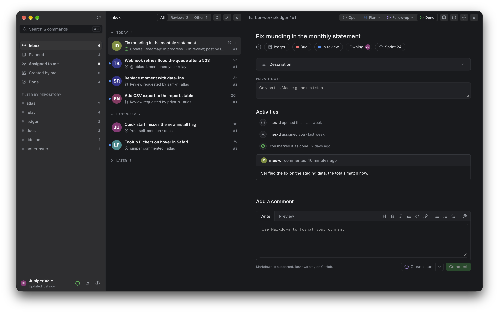

# Inbox for GitHub

A small macOS app that collects everything you are asked for on GitHub, so no request gets lost:
issues assigned to you, mentions you have not answered yet, and pull requests waiting for your
review. An item stays in the inbox until you act on it.



This is a personal project: I build it for my own work and publish it so others can use it too.
Issues with bugs or ideas are welcome. Pull requests are not expected, and updates come when
there is something to ship, not on a schedule.

## What it does

- **Five views:** *Inbox* (someone waits for you: a mention, a review request, new commits on a
  pull request you reviewed; your follow-ups wait in its *Later* bar), *Planned* (what you pinned
  for today or planned for a day), *Done*, *Assigned to me* (by type or board status, with "my
  part done") and *Created by me*. Answered mentions and reviews move to *Done* on their own;
  follow-ups and done items come back when someone needs you again. A light bulb in the detail
  view explains why an item is where it is.
- **Your own status** per item: open, today (T), planned for a day (P), follow-up (F) or done (D),
  with undo (⌘Z), plus a private note. Statuses, notes and their history live only on your Mac
  and are never sent to GitHub.
- **Reply from the app:** a comment box modeled on GitHub's, with Markdown toolbar and preview,
  plus close (as completed or not planned), reopen, and assigning or removing yourself (⌃A).
  Reviews, approvals and inline comments stay in GitHub's own UI.
- **Keyboard first:** the actions have keys (? lists them), and ⌘K opens a palette for commands
  and items.
  "Open in Orca" opens an item's repository in [Orca](https://github.com/stablyai/orca), cloning
  it first when needed.
- **Organizations and your personal repositories**, each narrowed to all repos, all but some,
  or only selected ones.
- **Works offline** from the last successful fetch, and keeps an eye on GitHub's hourly API
  budget: a ring in the sidebar footer shows what is left, and automatic refreshes wait when it
  runs low or GitHub asks to slow down.
- Board status and sprint from GitHub Projects, closed and merged items for a few days,
  notifications and a dock badge, English and German, light and dark mode. Every one of these
  can be switched or tuned in the settings.
- **A demo mode** with made-up organizations, people and items, for trying the app without
  touching your GitHub: ⌘K, "Show demo data".

## Requirements

- macOS, Node 26+ (the version in `.node-version`) and npm
- Rust (`brew install rustup && rustup default stable`)
- GitHub CLI, logged in: `gh auth login`. The app needs the scopes `repo`, `read:org` and
  `project`; if one is missing, it says so and shows the command that adds it
  (`gh auth refresh -s repo,read:org,project`).

## Run

```sh
npm install
npm run tauri dev                    # development window
npm run tauri build -- --bundles app -- --locked # src-tauri/target/release/bundle/macos/Inbox for GitHub.app
npm test                             # unit tests (vitest)
npm run lint                         # ESLint
```

On first start, pick the organizations to watch. Settings, statuses and the cached fetch are
stored in the app's local database under
`~/Library/Application Support/inbox-for-github/`, never in this
repository. The token is read from `gh` on every refresh and never stored.

A build of your own opens directly. A downloaded build is unsigned, so macOS blocks its first
start: open System Settings › Privacy & Security and choose "Open Anyway". Releases built in CI
carry the app as a zip for Apple Silicon; 0.1.0 and 0.2.0 are source only.

## Layout

- `src/github/` — GraphQL client, rate-limit handling, search and mutations
- `src/classify.ts`, `src/reopen.ts`, `src/review.ts`, `src/rules/` — which view an item belongs in
- `src/store.ts` — local SQLite store for settings, statuses, their history and the cache
- `src/ui/` — React UI; texts in `src/ui/locales/` (English is the source, German mirrors it)
- `src-tauri/` — the Tauri shell; `icons/icon.svg` is the source of the app icon

## Working on it

Start with [`AGENTS.md`](AGENTS.md) and [`CONTRIBUTING.md`](CONTRIBUTING.md); topic docs are in [`docs/`](docs/).
